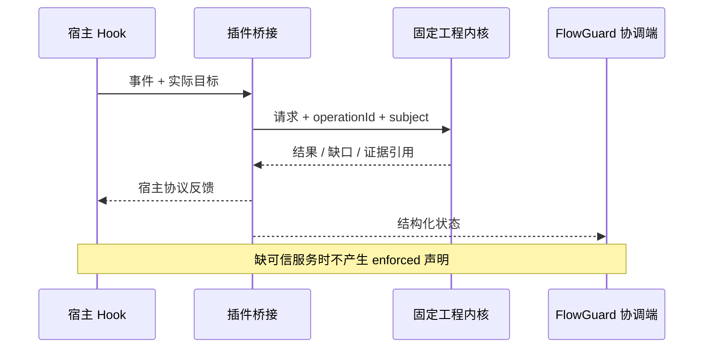

## Context

`2026-10-04-rust-lifecycle-default` 已描述 Rust 非阻断生命周期与 Python Git/MCP 兼容边界，仍有实际宿主/发行验收任务。当前 `hooks/rust_runtime_dispatch.cjs` 为固定运行时分发入口，旧 Python 扫描与 verdict 继续存在。详见 [proposal](proposal.md) 和 [spec](specs/engineering-host-bridge/spec.md)。

## Goals / Non-Goals

**Goals:** 让宿主调用统一验证能力并获得准确反馈，支持显式受控模式和互操作验证。

**Non-Goals:** 不在插件重写检查器，不借本规划宣布 Rust 全面替换 Python，不改变旧 skip/fail-open/点前缀范围语义，不直接改受管技能。

## Decisions

1. 核心协议 owner 为 codeguard/add-engineering-guard-core。宿主桥接只能将事件转换为带 operationId 的请求、执行固定制品、校验响应并呈现；不能自行组合第二套质量判定。
2. 现有 codeguard 和新 engineering-guard 分别锁定制品/版本/摘要/平台。不存在即显示准备指引；普通 Hook 不联网安装，不经 PATH 替换。未知协议不能切回 Python 后声称统一门禁通过。
3. standalone 保留当前行为；integrated-cooperative 只增加统一证据；enforced 需服务端 controller 与保护验收，不由本插件配置布尔值成立。旧 skipGate 可以保持兼容行为，但不能绕过独立受控门禁。
4. SessionStart 只发现和反馈；编辑成功后局部检查，失败编辑不宣称检查新源码；git commit 用 index，push 用待推对象，CI 用最终候选。未知 shell 写入按不确定范围重新规划，不能借用上次文件集。
5. 内容指纹+operationId+动作限定单飞；失败/取消和过期 run 保留。stdout/stderr 有界，日志私有，原始诊断不可作为宿主指令。多插件的共同问题由 FlowGuard 协调呈现，CodeReview 保留独立模型授权所有权。
6. rmcp 接入使用新工具命名空间并验证功能协商，旧 MCP 名称/参数和退出协议保留。stdio 不混写日志；MCP 不开放 grant 签发或通用 shell。

## Implementation surfaces

| 面 | 文件/模块 | 验收重点 |
|---|---|---|
| 固定运行时 | `hooks/rust_runtime_dispatch.cjs` 与现有安装器/锁 | 错摘要、缺平台、缺程序不执行 |
| 事件桥接 | `hooks/`、`scripts/codeguard/*application.py` 对应入口 | actual cwd、候选类型、预算、去重 |
| 协议 | 新版本 evidence adapter 与 Hook 协议 | 原结果不改写、非零映射正确 |
| MCP | 现有 MCP 兼容入口及新 stdio 入口 | 调用一致、版本不匹配不放行 |
| 技能分发 | `skills.lock.json` 与 local 白名单 | 上游改→不可变 tag→vendor，不在本仓改受管目录 |
| CI/宿主 | tests、manifest、发行证据 | CLI 重放和实际安装分别记录 |

## Risks / Trade-offs

- [双运行时漂移] → 锁定制品 + 同请求差分；不一口气迁移全部入口。
- [重复提示] → operationId 和问题 owner；已有授权复用，不跨插件写状态。
- [宿主无法阻断] → 反馈保持可用，硬门禁由 Git/CI 层兑现。

## Migration Plan

P0 增加只读探测与证据桥接；P1/P2 扩展架构、rmcp 和语言反馈；P3/P4 只消费稳定协议扩展。consumer-first 发布后显式启用；兼容旧运行时但不能降低项目必需契约。回滚固定版本并保留历史报告，无法满足受控策略则停止交付。

实施检查：受影响 unittest、`tests/run_all.py`、架构/语言注册表验证、vendor 离线与在线、生成文档/manifest parity、实际宿主触发与远端 CI。文档规划检查不代替这些运行门禁。
